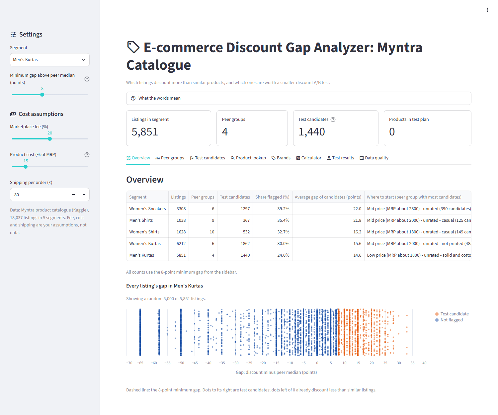
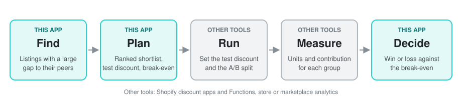
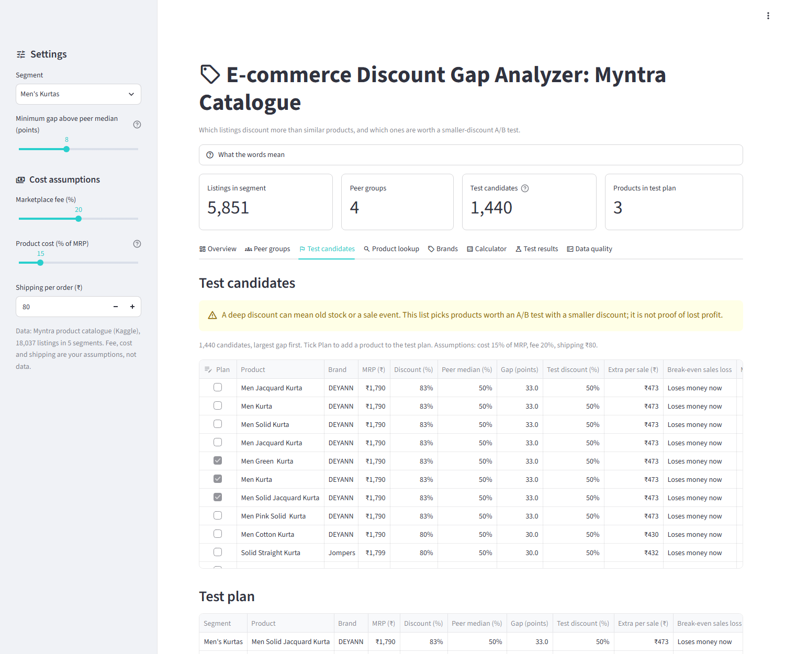
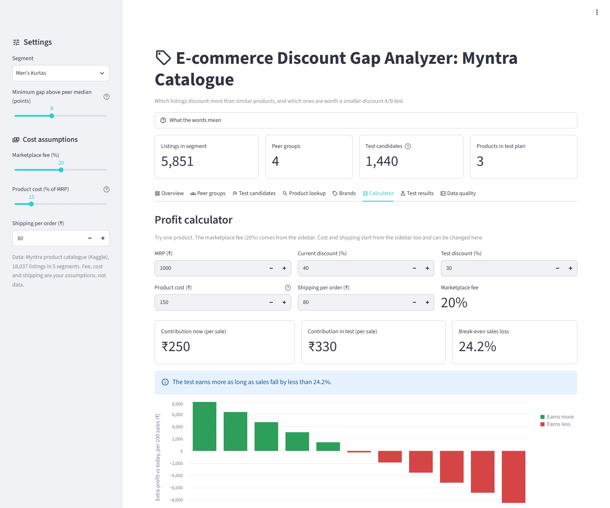
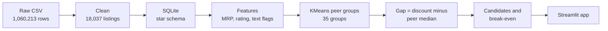

# E-commerce Discount Gap Analyzer: Myntra Catalogue

**Live app:** https://discount-gap-analyzer.streamlit.app/

**Project documents:** [Project report (PDF)](docs/Project_report.pdf) · [Presentation deck (PowerPoint)](docs/Discount_Gap_Analyzer_deck.pptx)

Fashion brands lose margin when there is a large gap between a product's discount and the discount on similar products. This project asks:

> **Which listings are discounted more than similar products, and which of them are worth testing at a smaller discount?**

It uses **KMeans clustering** to group 18,037 Myntra listings into 35 peer groups of similar products (by MRP, ratings and words in the product name, never by discount), compares each listing's discount with its group's median, and turns the gaps into a ranked list of A/B test candidates with a break-even check.

**Why peer groups?** A discount on a ₹500 kurta can't be compared with a discount on a ₹4,000 kurta or on sneakers. Each category and price level has its own normal discount, so a listing is only judged against products like it.



## How it fits with other discount tools

Most discount tools help a seller **run** discounts and **measure** sales. This app covers the steps before and after: **find** where a discount is out of line, **plan** the test, then **decide** on the result.



| Tool | What it does | How this app works with it |
|---|---|---|
| Shopify discount apps (for example Smart Discounts, Discount Prime) | Create, schedule and track sale prices and discount rules in a store | They run the smaller-discount test on the shortlist this app produces |
| Shopify native discounts and Functions | Built-in discount codes, automatic discounts and custom discount logic | The test discount and the A/B split can be set up here |
| Store or marketplace analytics | Units, revenue and orders per product | Supplies the test numbers that go into the Test results tab |
| Myntra's internal pricing systems | Large-scale, data-driven price and discount optimisation with A/B tests (Myntra has published research on this) | Same idea at a much smaller scale; this app is a transparent version a brand or category manager can use without a data science team |

**Exact products, not price ranges.** Discount tools and reports usually work on a whole collection or price range, for example "20% off all kurtas from ₹1,000 to ₹2,000", or "this range averages 55% off". An average like that mixes a few listings at 80% off with many at a normal level and hides both. Cutting the discount across the whole range would also hit products that are already in line and could lose their sales for nothing. This app pinpoints the exact listings with the largest gap, so the team gets a short, ranked list to act on: change those products' discounts, test them, and leave the rest alone.

**What this app adds:**
- **Peer comparison:** discount is judged against similar products, not one store-wide rule.
- **Explained flags:** every listing says in plain words why it is or isn't a candidate.
- **Margin first:** the break-even sales loss shows how much volume a smaller discount can afford to lose.
- **Test, then decide:** a clear win or loss rule set before the test, instead of changing prices on instinct.

**What it doesn't do:** it doesn't change prices or run the test itself, and it has no live sales data. Those stay with the store or marketplace tools.

## Key findings

- **5,498 of 18,037 listings (30%)** discount at least 8 points more than their peer median.
- A typical candidate gives **70% off where similar products give 55%**: a median gap of 15 points.
- **Women's Sneakers** has the highest share flagged (39%) even though it has the lowest median discount (40%), so whether a discount is high depends on the category.
- Some brands discount above their peers on almost every listing: for example, AfroJack, El Paso, Indian Fashionista and Oxolloxo have every one of their 50+ listings flagged.
- 8 of the 35 peer groups have under 100 listings, so their candidates are marked low confidence.

## What the app does

| Tab | What it shows |
|---|---|
| Overview | Discount spread and candidate share for the chosen segment |
| Peer groups | Each group's name, size and discount range (25th, 50th and 75th percentile) |
| Test candidates | Ranked listings with a gap of 8+ points; tick rows to build a test plan and download it as CSV |
| Product lookup | Search one product and see why it is or isn't flagged |
| Check a product | Enter a product that isn't in the catalogue (or upload a CSV of several) to see its peer group, gap, test-candidate status and break-even |
| Brands | Which brands discount above their peers most often |
| Calculator | Contribution per unit and the break-even sales loss for a smaller discount |
| Test results | Enter the A/B test numbers and get a win or loss against break-even |
| Data quality | The cleaning funnel and checks |

The sidebar sets the segment, the minimum gap (default 8 points), the marketplace fee (20%), product cost (15% of MRP) and shipping (₹80). Cost, fee and shipping are assumptions, because the data has no costs.



## How to use the app

1. **Pick a segment** in the sidebar, for example Women's Kurtas. Set your own fee, product cost and shipping if you know them; every number updates.
2. **Overview:** see how many listings are test candidates and which peer group has the most. That's where to start.
3. **Peer groups:** check what "similar products" means here: each group's name (price level, rating, product words) and its normal discount range.
4. **Brands:** see which brands discount more than similar listings most often, and which less.
5. **Product lookup:** search a product or brand to see why one listing is or isn't flagged, in one sentence.
6. **Check a product:** for a product that isn't in the catalogue, such as a new launch, enter its name, segment, MRP, selling price and ratings. The app puts it in the peer group of the most similar listings and shows its gap, whether it's a test candidate, and the break-even if its discount moved to the peer median. To check many at once, download the template, fill it in and upload it.
7. **Test candidates:** the list is ranked by gap, largest first. Tick **Plan** on the listings you want to test, then **Download test plan (CSV)**.
8. **Calculator:** put in one product's MRP, current discount and test discount to see contribution per sale and the break-even sales loss.
9. **Run the test** in your store or marketplace tools (see "The business test" below).
10. **Test results:** enter units and contribution per unit for the control and test groups to get a win or loss against break-even.

Hover over any chart point for a plain-language explanation, and open **What the words mean** under the title for the terms.

## Example workflow: a category manager for Women's Kurtas

**The situation:** a women's ethnic wear brand sells about 150 kurtas on Myntra. Margins are falling, and the team suspects some products are discounted more than they need to be, but cutting discounts across the range feels risky.

| Step | In the app | What they find (real numbers from the data) |
|---|---|---|
| 1. Size the problem | Sidebar: Women's Kurtas. Overview tab | 6,212 listings, 1,862 test candidates (30%) at the 8-point gap |
| 2. Pick a starting group | Overview "Where to start", then Peer groups | "Mid price (MRP about 2000), unrated, not printed": 1,499 similar kurtas, normal discount 56% off, 485 candidates |
| 3. Check their own brand | Brands tab, then Product lookup | Which of their kurtas sit above their peers, each with a reason like "70% off is 14 points above the 56% median of 1,499 similar listings" |
| 4. Build the shortlist | Test candidates: tick 60 of their listings in that group, skip "review first", download the CSV | A test plan their pricing team can load |
| 5. Check it's worth it | Calculator with their real cost and fee | For example, cutting 70% off to 56% off raises contribution per sale enough that units can fall by the break-even sales loss and they still earn more |
| 6. Run the test | Store or marketplace tools: half the shortlist at the peer median discount, half unchanged, for 3 weeks | Units and contribution for each half |
| 7. Decide | Test results tab | Units inside break-even: roll the smaller discount out to the rest of the group and repeat with the next group. Past break-even: keep the discount and learn that it is what sells those kurtas |

**What the team gets:** a short, ranked, explained list instead of a blanket discount cut; a break-even number agreed before the test; and a clear rule for reading the result.

## The business test

The app finds **where** to test; it does not prove a profit gain. A large gap is a signal, not proof: the discount may be clearing old stock, matching a competitor, or driving most of that product's sales. The only way to know whether shoppers still buy at a smaller discount is a controlled A/B test.

### The trade-off being tested

A smaller discount earns more on every sale but may sell fewer units. The **break-even sales loss** is how far units can fall before total profit drops. In the Calculator's default example (MRP ₹1,000, discount cut from 40% to 30%), contribution per sale rises from ₹250 to ₹330, so units can fall by up to 24.2% and the brand still earns more.



### Test design

| Part | Design | Why |
|---|---|---|
| Shortlist | 50 to 100 candidates from one segment, high-confidence peer groups only, nothing marked "review first"; CSV from the Test candidates tab | Enough products for a clear result, without unusual listings blurring it |
| Change | The test group moves to its peer median discount; the control group keeps today's discount | The peer median is a level similar products already sell at, so the new price is realistic, not a guess |
| Split | Shoppers split 50/50 at random; or, if showing two prices for one product isn't acceptable, half the listings in each peer group are test and half control | Every product keeps one price, and the peer groups keep the two halves comparable |
| Duration | 2 to 4 weeks, outside big sale events | Covers weekday, weekend and payday patterns; a sale would distort both groups |
| Main metric | Total contribution = units × contribution per unit | Units almost always fall when the discount shrinks; the question is whether profit rises |
| Guardrails | Return rate, search rank and visibility, customer complaints | A profit gain that damages ranking or customer trust isn't a real win |
| Win rule | Units fall by less than the break-even sales loss, fixed before the test starts | Fixing the rule in advance stops the result being read the way people hope |

### Reading the result (illustrative numbers)

A brand tests 60 Women's Sneakers listings at their peer median for 3 weeks. Contribution per unit rises from ₹100 to ₹140, so the break-even sales loss is 28.6%.

| Outcome | Units | Total contribution | Decision |
|---|---:|---:|---|
| Before | 1,000 | ₹1,00,000 | |
| Units fall 15% | 850 | ₹1,19,000 (+19%) | Win: roll the smaller discount out to the rest of the peer group |
| Units fall 35% | 650 | ₹91,000 (−9%) | Loss: keep the old discount; the gap was earning its sales |

The Test results tab does this comparison: enter units and contribution per unit for both groups, and it shows the change against break-even with a win or loss message. Before acting on a small difference, check it's larger than normal week-to-week swings in the control group, or run the test longer.

**Either way the brand learns something:** a win frees margin across similar listings; a loss shows that the discount is what sells those products, which is worth knowing before cutting it anywhere else.

**Status:** designed and ready to run, but not run, because the public data has no sales and I can't change Myntra's prices.

## Data

- **Source:** [Myntra Products Dataset](https://www.kaggle.com/datasets/ronakbokaria/myntra-products-dataset) on Kaggle (`myntra202305041052.csv`, 1.37 GB, 1,060,213 rows).
- **Snapshot date:** last updated 4 May 2023, so prices are a past snapshot, not today's.
- **Licence:** CC0 Public Domain.
- **Kept:** 18,037 listings after removing 237,241 duplicate product IDs, 787,972 rows outside the 5 categories, and 16,963 kids' or unknown-gender rows.

The raw file is not in this repository (it is too big); `data/processed/app.db` is.

## How it works



1. **Clean** (`src/clean.py`): remove duplicate product IDs, keep 5 segments (Men's and Women's Kurtas, Men's and Women's Shirts, Women's Sneakers), add gender from the product link.
2. **SQL layer** (`sql/schema.sql`, `src/load_db.py`): a small star schema (`dim_brand`, `dim_category`, `fact_listing`) with CHECK and foreign-key rules; reusable queries in `sql/metrics.sql`.
3. **Features** (`src/features.py`): scaled MRP (list price), rating and rating count, a has-rating flag and ten text flags from the product name (for example cotton, embroidered, solid).
4. **Peer groups** (`src/select_k.py` to `src/peer_groups.py`): KMeans on each segment separately. **Discount, selling price and brand are left out** (MRP is kept), so a group means "similar product", not "similar discount".
5. **Gaps and candidates** (`src/gaps.py`, `src/candidates.py`): gap = listing discount − peer median. A listing is a test candidate when the gap is 8 points or more. Groups under 100 listings are marked low confidence.
6. **Business rules** (`src/business.py`, tested in `tests/test_business.py`): contribution per unit, break-even sales loss and the test result comparison.
7. **App tables** (`src/app_tables.py`): one 7 MB `app.db` file that the app reads. It also stores each segment's scaling numbers and each peer group's centre.
8. **Placing new products** (`src/place_product.py`, tested in `tests/test_place_product.py`): a new product gets the same inputs as the clustering and joins the nearest peer-group centre in its segment, so no model is refitted. Run on all 18,037 catalogue listings, it puts every one back in its own group with the same gap.

## Model choice

- **KMeans, one model per segment.** k was chosen from 3 to 10 with two rules (no group over 40% of its segment, none under 30 listings), then by silhouette score and a 5-seed stability check. Final k: 4 to 10 per segment; stability (adjusted Rand index) 0.90 to 1.00.
- **MiniBatchKMeans was dropped.** It gave stability of only 0.48 to 0.67 on segments of a few thousand rows; plain KMeans gave up to 1.00.
- **HDBSCAN was compared and not used.** It left 15% to 56% of listings in no cluster (every listing needs a peer group to get a gap), found between 5 and 56 clusters, agreed poorly with KMeans (0.08 to 0.48), and changed a lot with its main setting.
- **Isolation Forest** flags unusual listings, which are marked "review first" instead of being dropped.

| Segment | Listings | Peer groups | Median discount | Test candidates |
|---|---:|---:|---:|---:|
| Men's Kurtas | 5,851 | 4 | 60% | 1,440 (25%) |
| Women's Kurtas | 6,212 | 6 | 57% | 1,862 (30%) |
| Women's Sneakers | 3,308 | 6 | 40% | 1,297 (39%) |
| Women's Shirts | 1,628 | 10 | 50% | 532 (33%) |
| Men's Shirts | 1,038 | 9 | 50% | 367 (35%) |

## Repository structure

```
ecommerce-discount-gap-analyzer/
├── app.py                      # Streamlit app: sidebar, cards and the nine tabs
├── src/
│   ├── clean.py                # Phase 2: clean the raw CSV, count every removed row
│   ├── load_db.py              # Phase 3: load the SQLite star schema
│   ├── check_metrics.py        # Phase 3: SQL queries checked against pandas
│   ├── features.py             # Phase 4: scaled MRP and ratings, text flags
│   ├── select_k.py             # Phase 5: try k = 3 to 10 per segment
│   ├── choose_k.py             #          keep k values that pass the size rules
│   ├── stability.py            #          5-seed stability check, final k
│   ├── peer_groups.py          #          KMeans peer groups with their names
│   ├── profile_groups.py       #          describe each group (for naming)
│   ├── hdbscan_check.py        #          HDBSCAN comparison
│   ├── anomalies.py            #          Isolation Forest "review first" flags
│   ├── business.py             # Phase 6: business rules (gap, contribution, break-even)
│   ├── gaps.py                 #          peer medians and each listing's gap
│   ├── candidates.py           #          test candidates and their reasons
│   ├── hand_check.py           #          10 listings checked by hand
│   ├── app_tables.py           #          build data/processed/app.db
│   ├── place_product.py        # Place a new product in its peer group
│   └── app_tabs/               # Phase 7: one file per tab, plus shared helpers
├── sql/
│   ├── schema.sql              # Star schema with CHECK and foreign-key rules
│   └── metrics.sql             # Reusable queries
├── tests/
│   ├── test_business.py        # Business-rule tests
│   └── test_place_product.py   # New-product placement tests
├── notebooks/                  # Data audit and cleaning checks
├── data/
│   ├── raw/                    # Raw Kaggle CSV (not in Git: 1.37 GB)
│   └── processed/              # Pipeline outputs; app.db is what the app reads
├── docs/
│   ├── Project_report.pdf      # Project report: problem, data, method, results, limits
│   ├── Discount_Gap_Analyzer_deck.pptx  # Presentation deck
│   └── images/                 # README screenshots and the workflow diagram
├── .streamlit/config.toml      # App theme
├── requirements.txt            # Packages the app needs (Streamlit Cloud)
└── requirements-dev.txt        # Plus pipeline, tests and notebooks
```

## Run it locally

```
git clone https://github.com/utkarshraj94/ecommerce-discount-gap-analyzer.git
cd ecommerce-discount-gap-analyzer
python -m venv .venv
.venv\Scripts\Activate.ps1
pip install -r requirements.txt
streamlit run app.py
```

To rebuild the data from the raw CSV, put the file in `data/raw/`, install `requirements-dev.txt`, and run the modules in this order:

```
python -m src.clean
python -m src.load_db
python -m src.features
python -m src.select_k
python -m src.choose_k
python -m src.stability
python -m src.peer_groups
python -m src.profile_groups
python -m src.hdbscan_check
python -m src.anomalies
python -m src.gaps
python -m src.candidates
python -m src.app_tables
python -m pytest
```

## Limits

- **Old snapshot:** prices are from May 2023.
- **No sales or cost data:** units sold, product cost, marketplace fees and shipping costs are internal business data. Myntra and its brands keep them private, and no public dataset includes them; the catalogue only shows what a shopper sees (MRP, selling price, discount, ratings). So the app can't see whether a higher discount sells more, and contribution uses assumed cost, fee and shipping, which you can change in the sidebar. A brand using the app would replace these assumptions with its own numbers.
- **Thin ratings:** 12,965 listings (72%) have no rating.
- **Peer groups come from MRP, ratings and words in the product name only:** no images, fabric details or sales history.
- **A gap is a reason to test, not proof** of lost margin.

## Next steps

- Run the A/B test with a brand that has sales data, and read it in the Test results tab.
- Add real cost and fee data per brand instead of assumptions.
- An "under-discounted" view for listings well below their peer median.
- A live data pipeline: a scheduled job that refreshes the tables from new catalogue data.
- Image or fabric features for better peer groups.

## Tools

Python, pandas, NumPy, scikit-learn (KMeans, HDBSCAN, Isolation Forest), SQLite and SQL, pytest, Streamlit, Altair.
